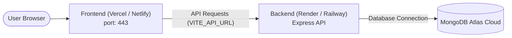

# 🎵 Spotify Clone (Full-Stack MERN)

<div align="center">


**A modern, production-ready music streaming web player inspired by Spotify.**  
*Crafted & Developed with ❤️ by **Dhruv**.*

[Live Demo](#-deployment-guide) • [Features](#-key-features) • [Tech Stack](#-technology-stack) • [Local Setup](#-local-development-setup) • [Deploy Guide](#-deployment-guide) • [API Reference](#-api-endpoints) • [Disclaimer](#️-legal-disclaimer--fair-use-notice)

</div>

---

## ⚖️ Legal Disclaimer & Fair Use Notice

> [!IMPORTANT]
> **Educational & Non-Commercial Showcase:**  
> This repository is developed purely for educational, academic, and portfolio demonstration purposes under the **Fair Use** doctrine (Section 107 of the US Copyright Act & Section 52 of the Indian Copyright Act, 1957).
> 
> - **Trademark Notice:** "Spotify", the Spotify logo, and brand aesthetics are registered trademarks of **Spotify AB**. This application is an independent open-source educational project and is **NOT** affiliated with, sponsored by, or endorsed by Spotify AB.
> - **100% Royalty-Free Audio & Media:** To prevent copyright infringement, all demo audio tracks in this project are licensed under **Royalty-Free / Creative Commons** terms (sourced via Bensound / Open Source assets). All album cover photos are sourced under the **Unsplash License** (free for use).
> - **Copyright Protection (*.mp3 Git-Ignored):** `.gitignore` rules prevent local audio files (`*.mp3`, `*.wav`) from being committed or distributed through GitHub.
> - **DMCA Takedown / Content Removal:** If you believe that any material within this repository infringes upon your copyright, please open a GitHub issue or contact the maintainer directly for immediate removal.

---

## 🚀 Overview

**Spotify Clone** is a full-featured music streaming web application built with the **MERN** stack (MongoDB, Express, React, Node.js) and bundled with **Vite**.

It replicates the official Spotify desktop & web player experience, featuring:
- Seamless HTML5 audio streaming with play/pause, seek scrubber, volume control, track looping, and next/previous track navigation.
- Real-time client-side search across tracks and artists.
- Secure JWT-based user authentication (Signup, Login, and persistent sessions).
- Sleek Spotify dark theme built with Tailwind CSS.

---

## ✨ Key Features

- **🎧 Audio Playback Engine**:
  - Play, pause, skip next, skip previous, and loop/repeat tracks.
  - Interactive seek/scrub bar with real-time current timestamp and track duration.
  - Volume slider with mute and volume restoration.
  - Heart/Like button toggle for tracks with instant UI response.

- **🔍 Live Search & Filter**:
  - Instant real-time filtering of songs and artists from the search bar.

- **🔐 User Authentication & State**:
  - User registration and login with encrypted password storage.
  - Secure JSON Web Tokens (JWT) for session management.
  - Profile state synchronized across Redux and LocalStorage.
  - Protected session validation route (`/api/user/me`).

- **🎨 Spotify Dark UI / UX**:
  - Accurate Spotify color palette (`#121212`, `#1ED760`, `#282828`).
  - Interactive hover cards with smooth animated play button transitions.
  - Sticky navigation header, collapsible sidebar, and persistent bottom player bar.

- **⚡ Modern Developer Experience**:
  - Fast HMR with **Vite** on frontend (Port `3000`).
  - Modular Express backend API (Port `8000`).
  - Production-ready environment variable configurations (`.env`).

---

## 🛠️ Technology Stack

| Layer | Technologies |
|---|---|
| **Frontend** | React 18, Vite, Redux, Redux-Thunk, React Router v6, Tailwind CSS, React Icons, React Toastify |
| **Backend** | Node.js, Express.js, Mongoose ODM, JSON Web Tokens (JWT), Dotenv, CORS |
| **Database** | MongoDB (Local MongoDB Community or Cloud MongoDB Atlas) |
| **Deployment** | Vercel (Frontend), Render / Railway (Backend), MongoDB Atlas (Database) |

---

## 📁 Project Structure

```
Spotify-Clone/
├── backend/
│   ├── Models/
│   │   └── User.js              # Mongoose User model schema
│   ├── Routes/
│   │   └── user.js              # Auth endpoints (login, register, me)
│   ├── helper/
│   │   └── generateToken.js     # JWT token generator
│   ├── .env                     # Backend environment variables
│   ├── .env.example             # Backend environment template
│   ├── db.js                    # MongoDB connection configuration
│   ├── package.json             # Backend dependencies and scripts
│   └── server.js                # Express app entry point (Port 8000)
│
├── frontend/
│   ├── public/
│   │   ├── assets/              # Audio tracks (.mp3) and album artwork
│   │   └── spotify.svg          # Spotify favicon
│   ├── src/
│   │   ├── Layout/              # Main app shell & sidebar layout
│   │   ├── components/
│   │   │   ├── Card/            # Track & playlist card with hover play
│   │   │   ├── Home/            # Home dashboard, search & song lists
│   │   │   ├── Login/           # Spotify login page
│   │   │   ├── Signup/          # Spotify registration page
│   │   │   ├── MasterBar/       # Persistent bottom audio player bar
│   │   │   └── Sidebar/         # Navigation & user library sidebar
│   │   ├── states/              # Redux store, actions, reducers & context
│   │   ├── App.jsx              # Main routing & toast notifications
│   │   ├── index.css            # Base Tailwind imports & scrollbars
│   │   └── main.jsx             # React DOM root entry
│   ├── .env                     # Frontend environment variables
│   ├── .env.example             # Frontend environment template
│   ├── package.json             # Frontend dependencies and scripts
│   ├── vercel.json              # Vercel SPA client rewrite configuration
│   └── vite.config.js           # Vite config (Port 3000)
│
├── .gitignore                   # Root gitignore rules
└── README.md                    # Project documentation
```

---

## ⚙️ Environment Variables

### Backend (`backend/.env`)

| Variable | Description | Example / Default |
|---|---|---|
| `PORT` | Port for Express server | `8000` |
| `JWT_SECRET` | Secret key used to sign JWT tokens | `your_secret_key_here` |
| `MONGO_URI` | MongoDB connection string | `mongodb://127.0.0.1:27017/SpotifyClone` or Atlas URI |

### Frontend (`frontend/.env`)

| Variable | Description | Example / Default |
|---|---|---|
| `VITE_API_URL` | Base URL of the backend API | `http://localhost:8000` *(Local)* or `https://your-api.onrender.com` *(Prod)* |

---

## ⚡ Local Development Setup

### Prerequisites
- [Node.js](https://nodejs.org/) (v16 or higher, v18+ recommended)
- [npm](https://www.npmjs.com/)
- [MongoDB](https://www.mongodb.com/try/download/community) running locally, or a [MongoDB Atlas](https://www.mongodb.com/atlas) connection string
- [Git](https://git-scm.com/)

---

### Step 1: Clone the Repository

```bash
git clone https://github.com/your-username/Spotify-Clone.git
cd Spotify-Clone
```

---

### Step 2: Setup & Run Backend

1. Navigate to the `backend` folder:
   ```bash
   cd backend
   npm install
   ```

2. Create a `.env` file in `backend/` (or copy from `.env.example`):
   ```env
   PORT=8000
   JWT_SECRET=dhruv_spotify_jwt_secret_key_2026
   MONGO_URI=mongodb://127.0.0.1:27017/SpotifyClone
   ```

3. Start the backend server:
   ```bash
   # Development mode with nodemon hot-reload:
   npm run dev

   # Or standard node execution:
   npm start
   ```
   > Server will be running at: **`http://localhost:8000`**

---

### Step 3: Setup & Run Frontend

1. Open a new terminal and navigate to the `frontend` folder:
   ```bash
   cd frontend
   npm install
   ```

2. Create a `.env` file in `frontend/` (or copy from `.env.example`):
   ```env
   VITE_API_URL=http://localhost:8000
   ```

3. Start the Vite dev server:
   ```bash
   npm run dev
   ```
   > Web application will be running at: **`http://localhost:3000`**

---

## 🌐 Deployment Guide

Follow these steps to deploy this full-stack application to the cloud for free.



### 1. Database Setup: MongoDB Atlas (Cloud)

1. Go to [MongoDB Atlas](https://www.mongodb.com/cloud/atlas) and create a free account.
2. Build a **Free Shared M0 Cluster**.
3. Under **Database Access**, create a database user (e.g. `admin`) and set a secure password.
4. Under **Network Access**, click **Add IP Address** and choose **Allow Access From Anywhere** (`0.0.0.0/0`) so hosted services can connect.
5. In your cluster dashboard, click **Connect** ➔ **Drivers** (Node.js) and copy your connection string:
   ```
   mongodb+srv://<username>:<password>@cluster0.xxxxx.mongodb.net/SpotifyClone?retryWrites=true&w=majority
   ```

---

### 2. Backend Deployment: Render / Railway

#### Using [Render.com](https://render.com/):
1. Sign in to Render and click **New +** ➔ **Web Service**.
2. Connect your GitHub repository.
3. Configure service settings:
   - **Name**: `spotify-clone-backend`
   - **Root Directory**: `backend`
   - **Environment**: `Node`
   - **Build Command**: `npm install`
   - **Start Command**: `npm start`
4. Add **Environment Variables** in Render:
   - `PORT`: `8000` (Render will automatically route port requests)
   - `JWT_SECRET`: `your_random_strong_secret`
   - `MONGO_URI`: `your_mongodb_atlas_connection_string`
5. Click **Create Web Service**. Once deployed, copy your backend live URL (e.g., `https://spotify-clone-backend.onrender.com`).

---

### 3. Frontend Deployment: Vercel

#### Using [Vercel](https://vercel.com/):
1. Sign in to Vercel and click **Add New...** ➔ **Project**.
2. Import your GitHub repository.
3. In project settings:
   - **Framework Preset**: `Vite`
   - **Root Directory**: `frontend`
   - **Build Command**: `npm run build`
   - **Output Directory**: `dist`
4. Expand **Environment Variables** and add:
   - `VITE_API_URL` = `https://spotify-clone-backend.onrender.com` *(Replace with your live backend URL from step 2)*
5. Click **Deploy**.
6. When deployment finishes, your Spotify Clone is live worldwide! 🎉

> **Note:** The included `frontend/vercel.json` already contains rewrite rules so React Router routes like `/login` and `/signup` work seamlessly without 404 errors on browser reload.

---

## 📡 API Endpoints

### Base URL: `http://localhost:8000` (Local) / `https://your-backend.onrender.com` (Prod)

| Method | Endpoint | Description | Request Body | Auth Required |
|---|---|---|---|:---:|
| `GET` | `/` | API status healthcheck | None | No |
| `POST` | `/api/user/register` | Register new user account | `{ username, email, password, gender }` | No |
| `POST` | `/api/user/login` | Authenticate user & receive JWT | `{ username, password }` | No |
| `GET` | `/api/user/me` | Fetch authenticated user profile | Header: `token: <jwt_token>` | Yes (JWT) |

### Sample Login Response:
```json
{
  "success": true,
  "token": "eyJhbGciOiJIUzI1NiIsInR5cCI6IkpXVCJ9...",
  "user": {
    "_id": "6724a1b8e4b09c1234567890",
    "username": "dhruv",
    "email": "dhruv@example.com",
    "gender": "Male"
  },
  "message": "Logged In Successfully"
}
```

---

## 🧪 Testing Locally

To test production build locally before deploying:

```bash
# In frontend directory
npm run build
npm run preview
```

---

## 🤝 Contributing

Contributions, issues, and feature requests are welcome!
1. Fork the Project
2. Create your Feature Branch (`git checkout -b feature/AmazingFeature`)
3. Commit your Changes (`git commit -m 'Add some AmazingFeature'`)
4. Push to the Branch (`git push origin feature/AmazingFeature`)
5. Open a Pull Request

---

## 👤 Author

**Dhruv**
- GitHub: [@your-username](https://github.com)
- Role: Full-Stack Developer

---

## 📄 License

This project is licensed under the **MIT License** - see the [LICENSE](LICENSE) file for details.
